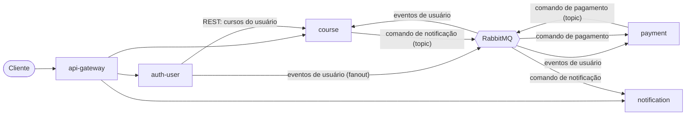

# Service Registry

## Sobre o projeto

Servidor de descoberta de serviços (Service Discovery) da plataforma EAD, baseado no Eureka. Os microsserviços se registram nele ao iniciar e se encontram pelo nome, sem endereços fixos. O acesso ao servidor é protegido por autenticação básica.

Projeto de portfólio com foco na infraestrutura de uma arquitetura de microsserviços.

## Funcionalidades

- Registro dos microsserviços e consulta de instâncias por nome
- Painel web do Eureka com os serviços registrados
- Acesso protegido por usuário e senha (HTTP Basic e formulário de login), com credenciais definidas por configuração
- Configuração por perfil: `dev` (local) e `prod` (variáveis de ambiente)

## Tecnologias utilizadas

- **Linguagem:** Java 21
- **Framework:** Spring Boot 4.1.0
- **Microsserviços:** Spring Cloud 2025.1.2 (Netflix Eureka Server)
- **Segurança:** Spring Security (autenticação básica, senha com BCrypt)
- **Build:** Maven

## Como executar o projeto

**Pré-requisito:** Java 21. Este é o primeiro serviço a subir.

1. Clone o repositório e use a branch `dev`:
   ```bash
   git clone https://github.com/LGui-santos/service-registry.git
   cd service-registry
   git checkout dev
   ./mvnw spring-boot:run
   ```
2. Acesse `http://localhost:8761` e entre com o usuário e a senha definidos em `src/main/resources/application-dev.yaml`.

**Em produção** (branch `prod`), o serviço lê as variáveis de ambiente `PORT`, `EUREKA_USERNAME`, `EUREKA_PASSWORD`, `EUREKA_URL` e `APP_DOMAIN_NAME`. O arquivo `system.properties` define o Java 21 para plataformas de deploy.

## Organização do projeto

```
src/main
├── java/com/ead/serviceregistry
│   ├── ServiceRegistryApplication.java   # @EnableEurekaServer
│   └── configs/WebSecurityConfig.java    # usuário em memória e autenticação básica
└── resources
    ├── application.yaml                  # nome da aplicação e perfil ativo
    ├── application-dev.yaml              # execução local
    └── application-prod.yaml             # execução em produção
```

## O que este projeto demonstra

- Service Discovery com Spring Cloud Netflix Eureka
- Proteção de infraestrutura com Spring Security
- Configuração por perfil e por variáveis de ambiente
- Preparação para deploy em plataformas de nuvem

## Melhorias futuras

- Executar mais de uma instância do servidor para alta disponibilidade
- Containerizar o serviço com Docker
- Criar um teste que verifique o acesso protegido ao painel

## Ecossistema EAD

Este projeto faz parte de uma plataforma de educação a distância (EAD) construída em microsserviços. Os serviços se descobrem pelo Eureka, buscam configuração no Config Server e se comunicam por REST e por mensageria (RabbitMQ).

| Serviço | Papel | Porta (dev) |
|---|---|---|
| [service-registry](https://github.com/LGui-santos/service-registry) | Service Discovery (Eureka Server) | 8761 |
| [config-server](https://github.com/LGui-santos/config-server) | Configuração centralizada (Spring Cloud Config) | 8888 |
| [ead-config-server-repo](https://github.com/LGui-santos/ead-config-server-repo) | Repositório de configurações dos serviços | - |
| [api-gateway](https://github.com/LGui-santos/api-gateway) | Ponto único de entrada | 8080 |
| [auth-user](https://github.com/LGui-santos/auth-user) | Usuários, autenticação e autorização | 8087 |
| [course](https://github.com/LGui-santos/course) | Cursos, módulos, lições e inscrições | 8082 |
| [payment](https://github.com/LGui-santos/payment) | Pagamentos com Stripe (em desenvolvimento) | 8086 |
| [notification](https://github.com/LGui-santos/notification) | Notificações aos usuários | 8084 |
| [notification-hexagonal](https://github.com/LGui-santos/notification-hexagonal) | Notificações em arquitetura hexagonal | 8084 |


